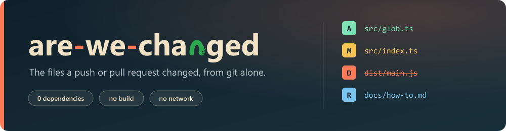

# are-we-changed



[](https://github.com/lowlysre/are-we-changed/actions/workflows/ci.yml)
[](https://opensource.org/licenses/MIT)

Reports the files a push, pull request, or merge group changed, filtered by glob patterns. It covers the commonly used part of [tj-actions/changed-files](https://github.com/tj-actions/changed-files).

- Zero runtime dependencies: Node built-ins and `git`
- No bundle, no build step: the TypeScript in `src/` is the code that runs
- No token, no API calls, no network access

## Contents

- [Quick start](#quick-start)
- [Can I migrate cleanly from tj-actions/changed-files?](#can-i-migrate-cleanly-from-tj-actionschanged-files)
- [Documentation](#documentation)
- [Related](#related)

## Quick start

Run tests only when something under `src/` changes.

```yaml
jobs:
  test:
    runs-on: ubuntu-latest
    steps:
      - uses: actions/checkout@v6
        with:
          fetch-depth: 2

      - uses: lowlysre/are-we-changed@<commit-sha>
        id: changed
        with:
          files: src/**

      - if: steps.changed.outputs.any_modified == 'true'
        run: npm test
```

> [!IMPORTANT]
> The action never fetches, so the checkout step has to bring the history. `fetch-depth: 2` covers a push of one commit and the default pull request checkout. `fetch-depth: 0` (all history) covers everything, and is required for a push of several commits, merge groups, `base_sha`, `since_last_remote_commit`, and a pull request checked out at its head branch.

`any_modified` is `'true'` when a matching file was added, modified, renamed, or deleted. A deleted source file can break what's left, so it's the right gate for tests. `any_changed` leaves deletions out, and `all_changed_files` holds the matching paths that still exist, space-separated.

There are no release tags yet, so pin to a full commit SHA.

## Can I migrate cleanly from tj-actions/changed-files?

Yes, if both of these hold for your [tj-actions/changed-files](https://github.com/tj-actions/changed-files) step:

- Every input you set is in the supported list below
- The checkout step has `fetch-depth: 2`, or `fetch-depth: 0` for all history (see [the fetch-depth table](docs/how-to.md#fix-is-not-available-in-this-checkout) for which one)

Then the migration is the `uses:` line and nothing else. Output names match.

Supported inputs (14 of upstream's 61):

| Area     | Inputs |
|----------|--------|
| Patterns | `files`, `files_ignore`, `files_yaml` |
| Dirs     | `dir_names`, `dir_names_max_depth` |
| Format   | `json`, `escape_json`, `matrix`, `separator`, `safe_output` |
| Commits  | `base_sha`, `sha`, `since_last_remote_commit`, `skip_same_sha` |

> [!WARNING]
> GitHub doesn't fail a step for an input the action doesn't declare. It logs an "Unexpected input(s)" warning and carries on, so a leftover `recover_deleted_files: true` is ignored without an error. Check before switching.

This command lists every use of something are-we-changed doesn't have. No output means a clean migration.

```sh
grep -rnE '^\s*(files(_ignore)?(_yaml)?_from_source_file|files_ignore_yaml|[a-z_]+_separator|include_all_old_new_renamed_files|since|until|path|quotepath|diff_relative|dir_names_(exclude_current_dir|include_files|deleted_files_include_only_deleted_dirs)|fetch_depth|skip_initial_fetch|fetch_additional_submodule_history|write_output_files|output_dir|output_renamed_files_as_deleted_and_added|recover_[a-z_]+|token|api_url|use_rest_api|fail_on_[a-z_]+|negation_patterns_first|exclude_(submodules|symlinks)|fetch_missing_history_max_retries|use_posix_path_separator|tags_(ignore_)?pattern):|outputs\.([a-z0-9_-]+_)?(any_added|only_[a-z]+|other_[a-z_]+|copied_files|type_changed_files|unmerged_files|unknown_files|all_changed_and_modified_files|all_old_new_renamed_files)' .github/workflows
```

The input half matches any step's `with:` keys, so `path:` and `token:` on a checkout step show up too. Ignore hits outside the changed-files step.

If it prints something, look the hit up here:

| You use | What to do |
|---------|------------|
| `token`, `api_url`, `fetch_depth`, `skip_initial_fetch`, `fetch_missing_history_max_retries`, `fail_on_initial_diff_error` | Delete them. Set `fetch-depth` on the checkout step instead |
| `files_ignore_yaml` | Move each pattern into its `files_yaml` group as a quoted `'!pattern'` |
| `files_separator`, `files_ignore_separator` | Put one pattern per line |
| `negation_patterns_first` | Delete it. Exclusions always win, whatever the order |
| `any_added` | Use `added_files_count != '0'` |
| `use_rest_api`, or no checkout step at all | Add a checkout step. There's no API mode |
| `path`, `diff_relative` | No equivalent. The action diffs the repository in the working directory and reports paths from its root |
| `recover_*`, `since`, `until`, `tags_*`, `*_from_source_file`, `write_output_files`, submodule inputs, `other_*` and `only_*` outputs, old/new rename pairs | No equivalent. Stay on upstream, or compute it in a following step |

A few behaviours differ even when every input is supported. The one most likely to bite: `files_yaml` patterns starting with `!` or `*` have to be quoted. [docs/migration.md](docs/migration.md) has the full list.

## Documentation

- [How-to guides](docs/how-to.md): matrix from changed directories, pattern groups, comparing two commits, fixing history errors, shell-safe output
- [Reference](docs/reference.md): inputs, outputs, which commits are compared, the glob dialect, the `files_yaml` format
- [Migrating from tj-actions/changed-files](docs/migration.md): behaviour differences and every [upstream](https://github.com/tj-actions/changed-files) input and output without an equivalent
- [Design notes](docs/explanation.md): why the action exists, why it never fetches, why the YAML parser is strict
- [Security](docs/SECURITY.md): what the action can reach, how it handles hostile file names, how to report a vulnerability

## Related

[are-we-good](https://github.com/lowlydba/are-we-good) is a sibling action by the same author. It rolls the results of many jobs and matrix legs into one pass/fail check, which pairs well with jobs that are-we-changed lets you skip.
